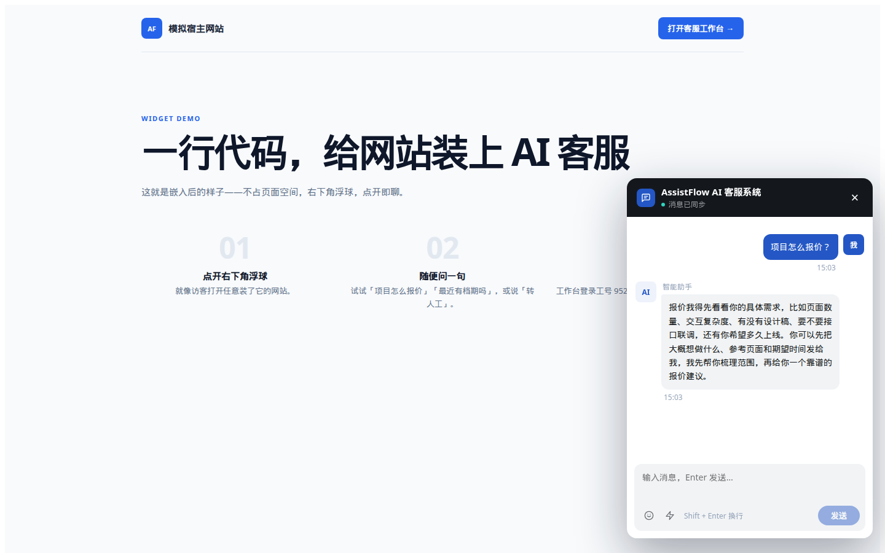
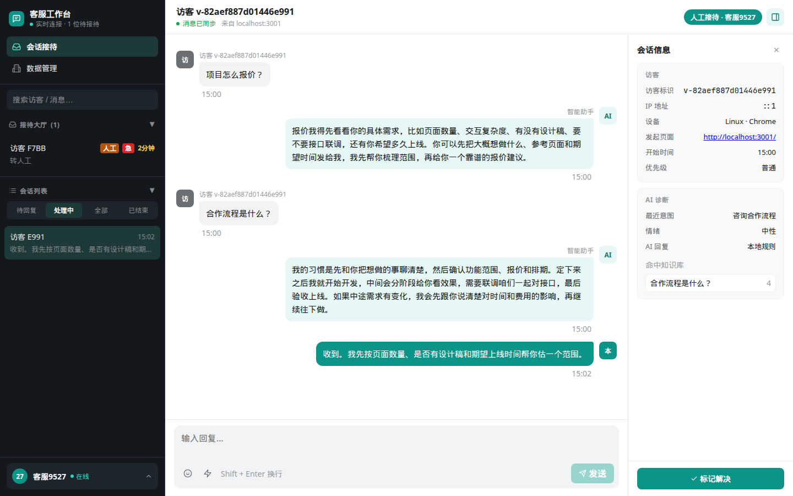
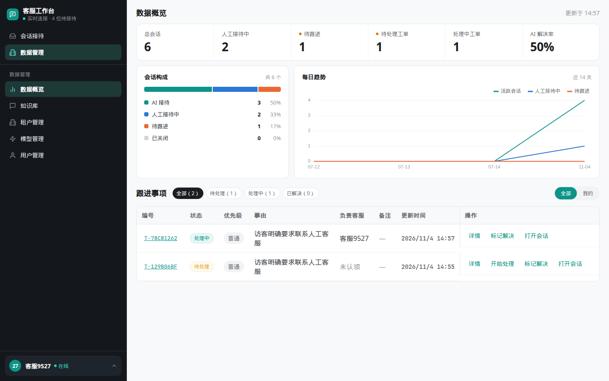
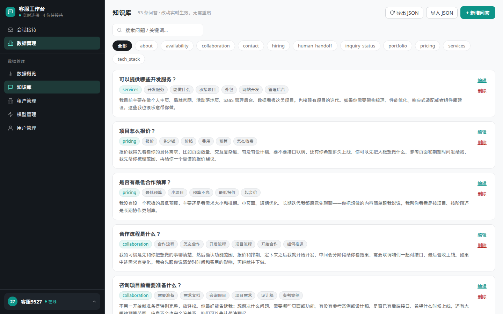
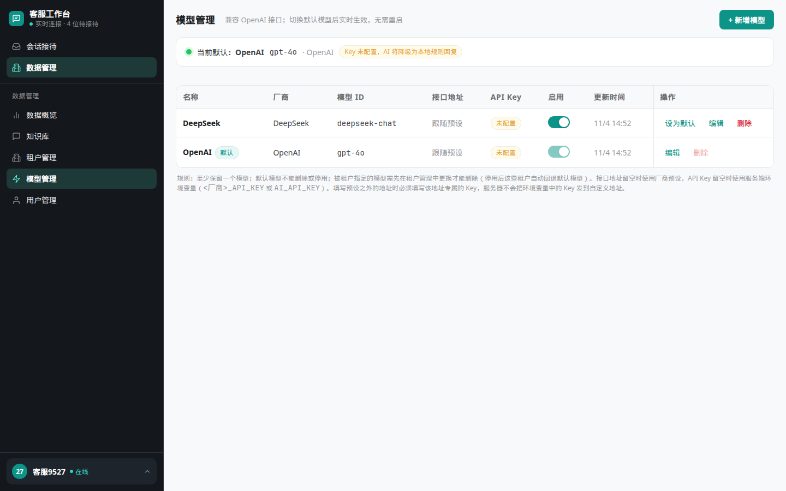
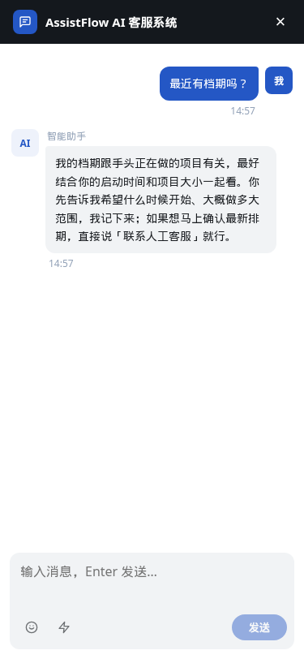
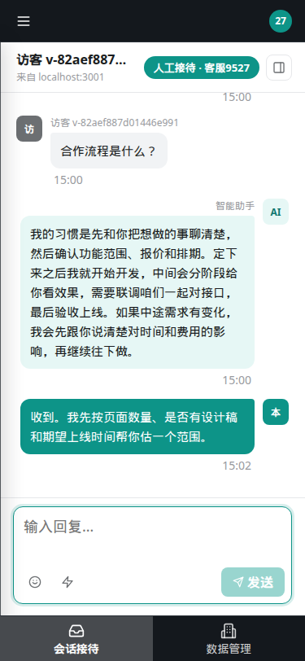
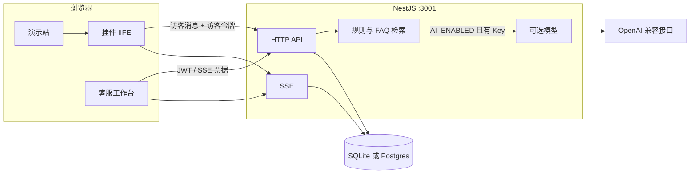

# AssistFlow

访客挂件嵌进任意网站，本地知识库先回答；只有访客明确要求转人工时，才把会话交给客服工作台。

A full-stack support desk: an embeddable widget, local FAQ by default, and a live agent workstation when the visitor asks for a human.

[](https://github.com/suijiafeng/ai-customer-support/actions/workflows/ci.yml)


## 界面

演示站使用仓库里的种子租户，未配置模型 Key 时回复来自本地 FAQ。下面的图都是本机跑起来之后用无头 Chrome 截的（桌面 1440×900，手机 375×812）。



挂件打成单个 IIFE，样式放在 Shadow DOM 里。演示页通过 `data-key` 和 `data-name` 带上种子租户；`apiBase` 默认取脚本自己的源，方便用同域反代藏起真正的 API 域名。



接待大厅里未被认领的会话对所有客服可见。客服发出第一条回复即把会话归给自己；已经归别人时，非管理员再回复会得到 409。右侧是意图、情绪和命中的知识库。



指标条、会话构成和近 14 日趋势。趋势由服务端按本地日期写入持久化后端，每 30 分钟一条。



FAQ 可搜索、筛选、导入导出。工作台保存后会立刻重建检索索引。



OpenAI 兼容的厂商预设。没填 Key 时对话降级到本地规则。自定义接口地址必须自带 Key，服务器不会把环境变量里的 Key 发到那个地址。

手机宽度下，挂件面板全屏，工作台改成顶栏加底部页签。

<p>
  
  
</p>

## 功能

**访客侧**

- 一行 script 嵌入。`data-theme` 换主题色，`data-title` 改标题。
- 租户用 `data-key` + `data-name` 成对校验；配置了域名时还会核对来源。
- 快捷提问直接用 FAQ 原题，点进去能命中对应回答。
- 会话用 SSE 推到挂件和工作台。访客令牌和客服令牌互相不能冒充。

**接待**

- 默认只走本地 FAQ 和规则。负面情绪、知识库未命中、查不到项目编号都不会自动转人工。
- 访客说出「转人工 / 找人工 / 真人沟通」才建跟进事项，会话进入接待大厅。
- 客服首条回复即认领。会话已经属于其他客服时，非管理员再回复返回 409。人工静默超过阈值（默认 10 分钟，`0` 为永不交还）后会话交还 AI。
- 管理员看全部会话和工单；普通客服只看自己的和未认领的。

**运营后台**（模型、用户、租户仅管理员）

- 数据概览、知识库、租户、模型、用户。
- 模型可增删改、启停、设默认；至少留一个，默认模型不能删、不能停。
- 租户可以指定模型。指定的模型没有可用 Key 时回退默认模型。

## 技术栈

| 层 | 选择 |
|---|---|
| 运行时 | Node.js 22+（SQLite 使用内置 `node:sqlite`，启动参数 `--experimental-sqlite`） |
| 服务 | NestJS 10、Express 5，同一进程托管 API 和三套前端产物 |
| 前端 | React 18、Vite 5、TypeScript 5 |
| 实时 | SSE。客服先换 60 秒票据再连接，长效 JWT 不放进 URL |
| 持久化 | 默认 SQLite，可换 Postgres，也可 `DB_DRIVER=memory` |
| 模型 | `openai` SDK，对接各家 OpenAI 兼容接口。默认关闭 |
| 图表 | ECharts 6 |
| 部署 | 根目录 Dockerfile、各前端 Dockerfile、`docker-compose.yml`、`render.yaml` |



检索是关键词加字符 bigram（Dice），不是向量。模型调用失败，或根本没开 AI 时，回复退回本地 FAQ / 兜底话术。

## 快速开始

需要 Node.js 22+。

```bash
npm install
npm run start -- dev
```

`dev` 会先构建全部 workspace，再拉起 shared、server 编译、server 进程、挂件和工作台的开发服务器。此模式把 `NODE_ENV` 设为 `development`，演示口令可以登录。本机已用下面的地址验证过登录和本地 FAQ 对话。

| 地址 | 用途 |
|---|---|
| http://localhost:5174/ | 客服工作台（热更新）。工号 `9527`，密码 `123456` |
| http://localhost:3001/api/health | 健康检查：FAQ 条数、持久化后端、AI 是否启用 |
| http://localhost:5173/ | 挂件源码预览。见下方说明，这里不能直接拿来对话 |
| http://localhost:3001/ | 已构建的演示站、`/workstation/`、`/widget/widget.js` |

演示站自己的 Vite 在 `5175`。要单独看它：`npm run dev --workspace assistflow-demo`。`npm run start -- demo` 会按生产形态构建，并为本机演示自动打开 `ALLOW_DEMO_CREDENTIALS`。

**3001 上的挂件。** `npm run start -- dev` 把 `NODE_ENV=development` 传给了预构建。这样产出的 widget / demo / workstation 包会在浏览器里抛 `jsxDEV is not a function`，3001 的浮球不会出现。工作台请用上面的 5174。若要在 3001 看嵌入对话，在开发服务已经起来之后另开终端：

```bash
NODE_ENV=production npm run build --workspace assistflow-widget
NODE_ENV=production npm run build --workspace assistflow-demo
```

刷新 http://localhost:3001/ 。演示页带的是空库启动时种下的那对租户（`apps/demo` 与 `apps/widget` 构建模板里的 `data-key` / `data-name`，和服务端 seed 一致）。5173 的预览页没有这两个属性，会退回源码里的另一组默认值，租户校验不会通过。

`npm run build`、`npm run start`、`npm run start -- demo` 在构建时不会把 `NODE_ENV` 留在 `development`，没有这个问题。`npm run start` 本身是生产模式，会拒绝演示口令。

### 演示账号

种子在 `apps/server/data/agents.json`。三个工号的口令都是 `123456`，`9527` 是管理员。

| 工号 | 名称 | 角色 |
|---|---|---|
| `9527` | 客服9527 | 管理员 |
| `9528` | 客服9528 | 客服 |
| `9529` | 客服9529 | 客服 |

`NODE_ENV=production`（Docker、Render、`npm run start`）拒绝这个口令，除非显式设置 `ALLOW_DEMO_CREDENTIALS=true`（也接受 `1` / `yes` / `on`）。改完密码后关掉该变量并重启。改密码不会让已经发出的 JWT 提前失效；要立刻切断访问，停用或删除账号。直接改 `agents.json` 不会热加载，需要重启。

### 环境变量

不创建任何 env 文件也能启动，缺省值在 `apps/server/src/config.ts`。复制 `.env.example` 为 `.env.local` 写本机配置。加载顺序：进程环境变量 > `.env.local` > `.env`。`.env.example` 注释里的 `github` 厂商预设已经从代码移除，设了不会命中。

布尔开关（`AI_ENABLED`、`DEMO_ENABLED`、`WIDGET_ENABLED`、`WORKSTATION_ENABLED`）空值用默认；`1` / `true` / `yes` / `on` 为开，其余为关。

| 变量 | 默认 | 必填 | 含义 |
|---|---|---|---|
| `PORT` | `3001` | 否 | 监听端口 |
| `NODE_ENV` | 空 | 否 | `production` 时收紧错误详情，并拒绝演示口令 `123456` |
| `ALLOW_DEMO_CREDENTIALS` | 生产关闭 | 否 | 仅生产环境有意义。打开后才允许演示口令登录 |
| `AUTH_SECRET` | 自动生成 | 多实例必填 | 客服 JWT、SSE 票据、访客令牌的 HMAC 密钥。未设置时写入 `DATA_DIR/.auth_secret`；写失败则只活在本次进程 |
| `AI_ENABLED` | `false` | 否 | 模型总开关。关闭或没有 Key 时只用本地 FAQ |
| `AI_PROVIDER` | 按地址推断，否则 `openai` | 否 | 厂商预设，见下表 |
| `AI_API_KEY` | 空 | 开 AI 时需要 | 也认旧名 `OPENAI_API_KEY`、`DEEPSEEK_API_KEY`。厂商专属变量 `<PROVIDER>_API_KEY` 优先 |
| `AI_BASE_URL` | 预设地址 | `custom` 必填 | 覆盖预设，或指向自建网关 |
| `AI_MODEL` | 预设模型 | 否 | 覆盖预设模型名 |
| `HANDOFF_IDLE_RELEASE_MINUTES` | `10` | 否 | 人工静默多久交还 AI。`0` 永不交还 |
| `HANDOFF_NOTICE_COOLDOWN_MINUTES` | `5` | 否 | 「客服已接入」系统提示的最小间隔 |
| `DB_DRIVER` | 有 `DATABASE_URL` 则 postgres，否则 sqlite | 否 | `sqlite` / `postgres` / `memory` |
| `DATABASE_URL` | 空 | 用 Postgres 时必填 | Postgres 连接串 |
| `SQLITE_PATH` | `DATA_DIR/assistflow.db` | 否 | Docker 镜像里是 `/data/assistflow.db` |
| `DATA_DIR` | `apps/server/data` | 否 | FAQ、账号、话术目录 |
| `TRUST_PROXY` | 空（不信任转发头） | 否 | 交给 Express `trust proxy`。空则不读 `x-forwarded-*`。`render.yaml` 设为 `1` |
| `CORS_ORIGINS` | 空（`cors` 默认 `*`） | 否 | 逗号分隔的来源白名单。设置后允许 `Authorization`、`Content-Type`、`x-visitor-token` |
| `ALLOW_ANON_SESSION_READ` | 关 | 否 | 只有严格等于 `true` 才放行不带访客令牌的读取和续写 |
| `ALERT_WEBHOOK_URL` | 空 | 否 | 持久化写失败时 POST `{ text }`。同一 5 分钟最多一次 |
| `DEMO_ENABLED` | `true` | 否 | 是否托管根路径演示站 |
| `WIDGET_ENABLED` | `true` | 否 | 是否托管 `/widget/widget.js` |
| `WORKSTATION_ENABLED` | `true` | 否 | 是否托管 `/workstation/` |

前端构建期变量（独立部署时才需要）：工作台 `VITE_API_BASE`、`VITE_SSE_BASE`、`VITE_BASE_PATH`（独立站点要设成 `/`，默认为 `/workstation/`）；演示站 `VITE_WIDGET_SRC`、`VITE_WORKSTATION_URL`、`VITE_API_BASE`。

`AI_PROVIDER` 选中预设后通常只填 `AI_API_KEY`：

| `AI_PROVIDER` | 默认模型 | 默认接口 |
|---|---|---|
| `openai` | `gpt-4o` | SDK 默认（官方） |
| `deepseek` | `deepseek-chat` | `https://api.deepseek.com` |
| `anthropic` | `claude-sonnet-4-5` | `https://api.anthropic.com/v1` |
| `gemini` | `gemini-2.5-flash` | `https://generativelanguage.googleapis.com/v1beta/openai/` |
| `zhipu` | `glm-4.7-flash` | `https://open.bigmodel.cn/api/paas/v4` |
| `moonshot` | `moonshot-v1-8k` | `https://api.moonshot.cn/v1` |
| `qwen` | `qwen-plus` | `https://dashscope.aliyuncs.com/compatible-mode/v1` |
| `openrouter` | `openai/gpt-4o` | `https://openrouter.ai/api/v1` |
| `groq` | `llama-3.3-70b-versatile` | `https://api.groq.com/openai/v1` |
| `siliconflow` | `deepseek-ai/DeepSeek-V3` | `https://api.siliconflow.cn/v1` |
| `xai` | `grok-4` | `https://api.x.ai/v1` |
| `ollama` | `qwen3:8b` | `http://localhost:11434/v1`（可不填 Key） |
| `custom` | 需自填 `AI_MODEL` | 需自填 `AI_BASE_URL` |

工作台里接口地址留空，走厂商预设或进程启动时的 `AI_BASE_URL`，Key 留空则用环境变量。地址一旦和该厂商官方主机、以及本进程为该厂商解析出的 `AI_BASE_URL` 不是同一协议、主机和端口，就必须填这条模型自己的 Key。Ollama 这类不需鉴权的本地服务可以改地址，连接时只用占位串。已经写在 `model-settings.json` 里的自定义地址如果没有专属 Key，调用时也不会补上环境变量 Key。

### 测试与构建

```bash
npm test          # 构建 server 并运行 apps/server/test。本次核对 150 项通过
npm run build     # shared → server → widget → workstation → demo
npm run smoke     # 需已有服务。默认打 http://localhost:3001，可用 SMOKE_BASE_URL 改
node scripts/dialog-test.js
```

`npm run kb:drafts -- --input miss.json --top 20 --out faq-drafts.json` 把未命中问句转成 FAQ 草稿，不直接入库。`npm run shots` 用本机 Chrome 再拍一组图到 `docs/screenshots/`（服务需已启动）。

### 部署

没有公开的在线地址写在仓库里。三种走法都在代码里：

1. **单容器。** 根目录 `Dockerfile` 同时装入 API、演示站、挂件和工作台。`DEMO_ENABLED` / `WIDGET_ENABLED` / `WORKSTATION_ENABLED` 默认开，设为 `false` 就只留 API，不用重打镜像。SQLite 写在 `/data`，自托管要挂卷。CI 会构建该镜像并请求 `/api/health`。
2. **拆开。** `docker-compose.yml` 起 Postgres、API（三个静态站点默认关）、工作台 `8081`、挂件 `8082`、演示站 `8080`。工作台也可以按根目录 `vercel.json` 只发静态资源。
3. **Render。** `render.yaml` 用 Docker，`healthCheckPath` 为 `/api/health`，`AUTH_SECRET` 由平台生成，`TRUST_PROXY=1`。Free 实例磁盘不持久，SQLite 会在重新部署时清空；要留数据就填 `DATABASE_URL`，或挂磁盘到 `/data`。

生产环境请设置 `AUTH_SECRET`。未设置时进程仍会启动，并生成密钥、打告警。多实例必须用同一个值。

## 目录

```
apps/server          NestJS：API、SSE、规则、模型、静态托管
apps/server/data     FAQ、项目进展、客服种子、话术 JSON
apps/workstation     React 工作台
apps/widget          挂件，构建为 dist/widget.js
apps/demo            模拟宿主站
packages/shared      前后端共用的类型和常量
scripts              start.js、smoke、对话回归、截图
.github/workflows    push / PR 到 main 与 develop 时构建、单测、镜像健康检查
```

知识库正文是一份独立前端开发者的站点文案（服务范围、报价、合作、档期）。换行业时改 `apps/server/data/` 里的 JSON。`faqs.json`、`inquiries.json`、`small-talk.json` 有文件监听，保存后约 500ms 热加载。`business-terms.json`、`reply-templates.json`、`fallback-scripts.json` 只在进程启动时读取。

## 实现上值得看的地方

**身份。** 客服口令用 scrypt 加盐。JWT 是 HMAC-SHA256，角色写在令牌里，但每次请求都再对照当前账号：停用或删除后立即失效，降级之后不能继续当管理员。SSE 用 60 秒票据（`POST /api/auth/sse-ticket`）。访客令牌带 `kind: 'visitor'`，和客服令牌、SSE 票据互相拒绝。续写已有会话必须带 `x-visitor-token`，首条消息才签发。登录每分钟每 IP 5 次，对话 20 次。

**模型 Key。** 自定义 `baseUrl` 不会收到服务器环境变量里的 Key。这是为了避免把 Key 发到管理员填写的任意地址。列表接口只回脱敏后的末四位。

**数据。** 热数据在内存 `Map`（会话上限 200，按最近使用淘汰），写入落到 SQLite 或 Postgres；淘汰的会话详情还可以从库里读回。`DB_DRIVER=memory` 或持久化初始化失败时退化为纯内存。每日趋势是快照，不是实时曲线。未配置 `TRUST_PROXY` 时访客 IP 只取 `req.ip`，不读可伪造的 `x-forwarded-for`。

**测试。** `apps/server/test` 覆盖规则检索、鉴权与演示口令、访客令牌隔离、模型自定义地址、工单和存储写失败告警。CI 在 `main` 和 `develop` 的 push 与 pull request 上跑构建、这套测试，以及生产镜像的健康检查。

## 已知限制

- FAQ 是关键词和 bigram，不是语义检索。
- 运行时热集合在内存里。多实例不会互相广播 SSE。
- 每日趋势约 30 分钟写一次。`DB_DRIVER=memory` 时重启即清空。
- 访客挂件的图片发送入口是关的（`imageEnabled = false`）。工作台仍可发送 data URL 图片，每张不超过 2MB，最多 4 张，不适合当作生产里的对象存储。
- 首条访客消息发出时，会话 SSE 会在访客令牌签发之前就去连接，界面会停在「正在同步」。刷新之后令牌已经在本地，状态会变成「消息已同步」。
- `npm run start -- dev` 的预构建产物不能直接当 3001 的挂件用，见快速开始。
- 仓库没有约定对外的部署 URL。`docs/FEATURE-IDEAS.md` 是对照其他开源客服产品整理的想法，不是已排期的功能。`docs/ARCHITECTURE.md` 写的是更早的 Socket.IO / Prisma 方案，文件开头已标明过时。

## License

[MIT](./LICENSE)

---

> **声明**：本仓库为个人项目，仅供学习交流。
