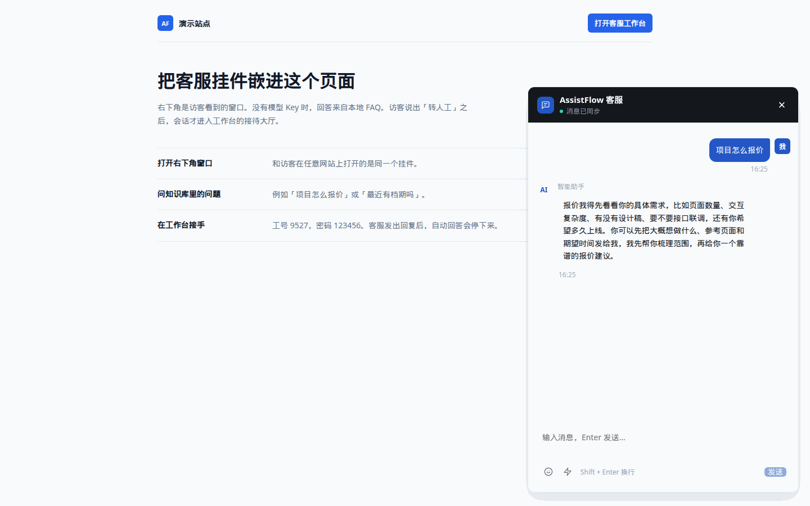
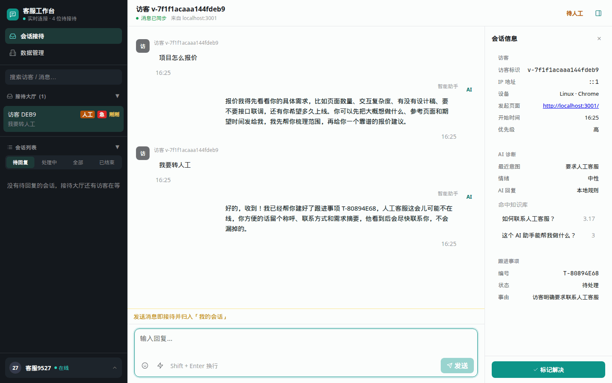
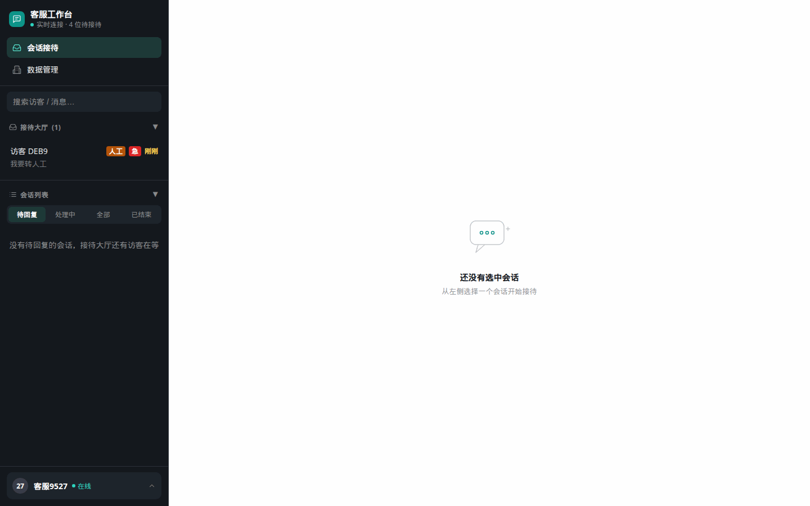
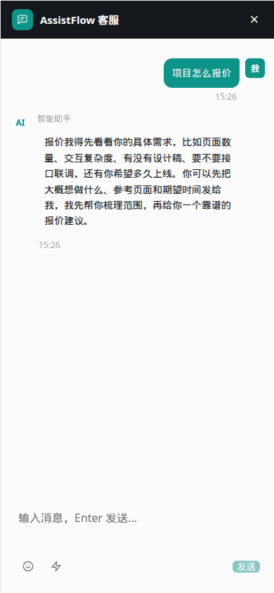

# AssistFlow

嵌进网站的客服挂件，加上给客服用的工作台。没配模型 Key 时用本地 FAQ 回答；访客说出「转人工」后，会话才交给人工。

<table>
  <tr>
    <td align="center" valign="top">
      
      <br />本地 FAQ：没配模型 Key 也能回答
    </td>
    <td align="center" valign="top">
      
      <br />转人工后：对话、意图和跟进事项在一屏
    </td>
  </tr>
  <tr>
    <td align="center" valign="top">
      
      <br />接待大厅：还没被认领的转人工会话
    </td>
    <td align="center" valign="top">
      
      <br />窄屏：挂件铺满手机屏幕
    </td>
  </tr>
</table>

## 功能

- 一行 script 嵌入挂件（Shadow DOM）。租户用 `data-key` 和 `data-name` 成对校验，配了域名还会核对来源。
- 默认走本地 FAQ（关键词加字符 bigram）。`AI_ENABLED` 默认关闭，没有 Key 不会请求模型。
- 只有「转人工 / 找人工 / 真人沟通」会建立跟进事项并进入接待大厅。客服第一条回复即认领；会话已经属于别人时，非管理员再回复返回 409。
- 工作台有会话、跟进事项、知识库和数据概览。管理员还可以管理租户、模型和用户。
- 挂件和工作台用 SSE 收消息。访客令牌、客服 JWT、SSE 票据互相不能冒充。

## 技术栈

Node.js 22、NestJS 10、React 18、Vite 5、TypeScript 5、SSE、SQLite（可换 Postgres）、ECharts。模型是可选的 OpenAI 兼容接口。

## 值得看的地方

- 同一个 Nest 进程托管 API、演示站、挂件和工作台。客服的 SSE 先换 60 秒票据，长效 JWT 不放进 URL。
- 角色写在 JWT 里，但每次请求都再对照当前账号：停用或降级后立刻失效。
- 热数据在内存里，按最近使用淘汰，同时写入 SQLite 或 Postgres；淘汰掉的会话还能从库里读回。
- `npm test` 跑服务端测试，`npm run smoke` 覆盖登录、转人工和工单。CI 在 `main` 和 `develop` 上构建、跑测试，并检查生产镜像的 `/api/health`。

## 快速开始

需要 Node.js 22+。不需要 API Key。

```bash
npm install
npm run start -- demo
```

| 地址 | 说明 |
|---|---|
| http://localhost:3001/ | 演示站和挂件 |
| http://localhost:3001/workstation/ | 工作台。工号 `9527`，密码 `123456` |

`9527` 是管理员，`9528` 和 `9529` 是客服，密码都是 `123456`。`demo` 会打开 `ALLOW_DEMO_CREDENTIALS`。直接 `npm run start` 是生产模式，会拒绝这个口令。

## 目录

```
apps/server        API、SSE、FAQ 检索、静态托管
apps/widget        访客挂件
apps/workstation   客服工作台
apps/demo          演示站
packages/shared    共用类型
```

环境变量、部署和客服 Agent 的工具调用见 [docs/reference.md](./docs/reference.md)。

[MIT](./LICENSE)
